# 2D Explainer Long Videos — Master Skill & Production Runbook

This skill documents the exact workflow, visual DNA, character rules, and high-speed procedural rendering architecture used to analyze and recreate long-form **2D Explainer & Survival Storytelling Videos** (`1920x1080`, `30 FPS`, 8–15+ minutes, 100+ shots) from scratch.

---

## 1. How I Give Instructions (User's Core Method & Rules)

Whenever I ask you to create or recreate a video using this skill, follow my exact instruction method and non-negotiable rules:

### Rule #1: Protagonist Identity is ALWAYS **"Chad"** (Never "Melvin")
- My main character's name is **"Chad"** (`Chad H.` / `CHAD`).
- If a reference video uses another name (such as `"Melvin"`), you **MUST replace it with `"Chad"`** everywhere:
  - **Emails / Letters / Messages:** e.g., `To: Chad`
  - **Sign-Up Sheets / Volunteer Cards / IDs:** e.g., `Chad H.`
  - **Credit / Debit Cards / Bank Screens:** e.g., `CHAD` (`•••• 2930`)
  - **Phone Calls / Speech Bubbles / Captions:** Anyone calling or addressing the protagonist uses `"Chad"`.
  - **Codebase & Rigs:** Name the character rig function `draw_chad(...)` across all engine modules and storyboard UIs.

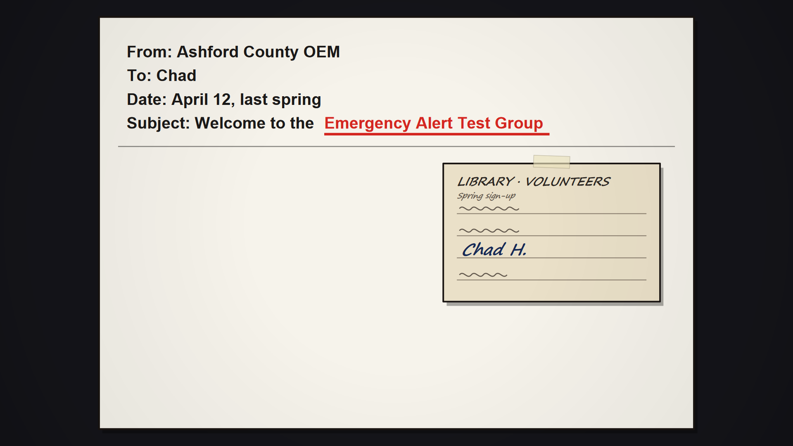

### Rule #2: The `"Exact Video"` Forensic Analysis Method
1. **Drop & Inspect:** I provide a reference video (e.g., `Exact Video.mp4`) and ask you to read and analyze it completely and carefully, then recreate the exact same visual style, hyper-active audience-grabbing animation, kinetic overlays, and pacing from scratch.
2. **Never Copy Video Frames:** Every single frame of the output MP4 must be rendered **100% from scratch** via procedural 2D vector code (`PyCairo`), then muxed with the audio track.
3. **Complete Timeline Inspection (Zero Guessing):**
   - Run `ffprobe` to get exact resolution (`1920x1080`), frame rate (`30 fps`), duration (`590.87s`), and total frame count (`17,726`).
   - Extract 60-second video chunks (`clip_0_60.mp4`, `clip_60_120.mp4`, …) and 35–45 full-resolution 1080p keyframes (`frame_*.jpg`) at every major visual beat.
   - Inspect every clip and keyframe using `read_file` to map out a complete **100+ Shot Master Timeline** (`t0`, `t1`, camera `zoom0 -> zoom1`, `pan_x`, `pan_y`, `shake`, `red_pulse`, and scene callback).
4. **Iterative Customization:** When I ask for a character name change, prop tweak, or visual adjustment after the first render, update the specific scene module, re-render the affected segment(s) in parallel via `h264_nvenc`, and re-mux immediately.

---

## 2. Visual & Kinetic Style Bible (With Reference Screenshots)

Every video in this style is built from **five signature visual layers** that keep viewer retention high by introducing a new kinetic movement, handwritten note, or cutaway every **2.5 to 5.5 seconds**:

### A. Rigged 2D Protagonist ("Chad")
- **Proportions & Palette:**
  - Oversized round off-white head (`#EAE4DC`) with thick charcoal-black ink outlines (`#1A1512`, `4.0–5.5 px` round caps/joins).
  - Backward crimson baseball cap (`#B5423D`) with a front keyhole cutout showing spiky dark-brown hair tufts (`#3A2B22`).
  - Quilted dark-slate puffy vest (`#3D3E44`) with horizontal stitch lines over a dark long-sleeve shirt.
  - Stick arms (`5.5 px` black strokes) with round white cartoon hands and stick legs with flat oval shoes.
- **Poses & Expressions:**
  - Expressions: `neutral`, `worried`, `shocked` (wide white sclerae + dilated pupils), `grimace_teeth`, `wince`, `panting`, `asleep`, `angry`.
  - Poses: `idle`, `walk` (sine-wave leg/arm swing + head bob), `sleep_bed`, `sit_bed`, `sit_chair`, `phone_ear`, `phone_look`, `point_right`, `tremble_jugs`, `crouch`, `brace_door`, `aim_extinguisher`.

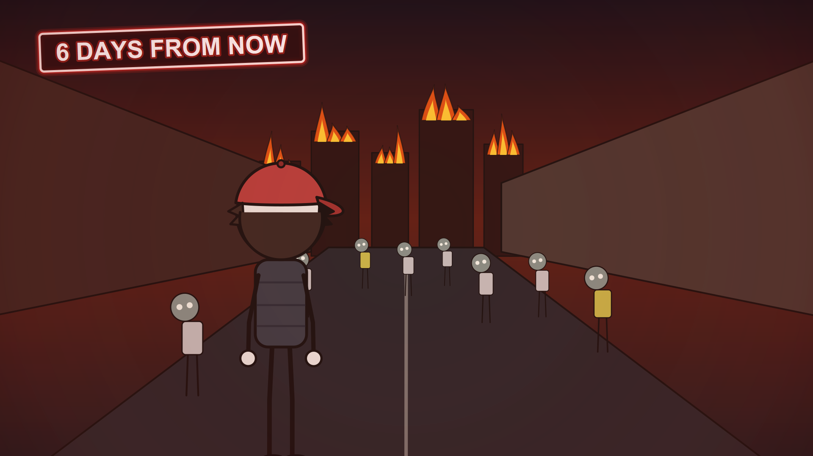

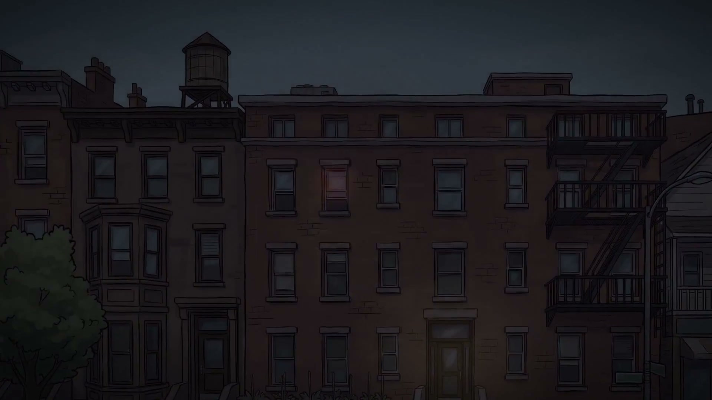

---

### B. Tactile Spiral Notebooks & Live Moving Pen Hand (`draw_notebook_card`)
- **Paper Construction:** Cream lined paper (`#F5F0DC`), horizontal light-blue ruled lines, vertical red margin line, 3 punched binder holes, silver wire spiral rings on the left edge, and translucent tilted scotch tape (`draw_scotch_tape`) at top-right.
- **Live Writing Hand (`draw_hand_with_pen`):** A long dark-sleeved arm with a white cartoon hand holding a blue, black, or red marker tracks the active character or bar being drawn in real time!
- **Row Types:**
  1. `bar_row`: Mini vector icon (`water`, `food`, `cash`) + progressive handwritten label + rectangular meter filled with diagonal colored hatch lines (`#3B8EEA` blue, `#E8922D` orange, `#58B86C` green). Supports red strikethrough updates (`2 gal -> 30 gal`, `3 -> 24 days`, `$40 -> $640`).
  2. `tally`: Five-stroke tally groups (`||||` in blue ink + diagonal 5th slash `/` in red ink) with a live counter (`JUGS 3..28`, `TRIP 1..11/11`).
  3. `pass_row`: Large colored acrostic letters (`P-A-S-S` for `HOW TO FIGHT A FIRE`: Pull the pin, Aim at the BASE, Squeeze, Sweep side to side).
  4. `month_droplets`: 6×5 grid of 30 blue water droplets (`30 GAL = 1 MONTH`).

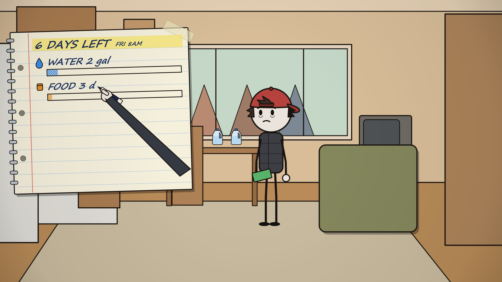

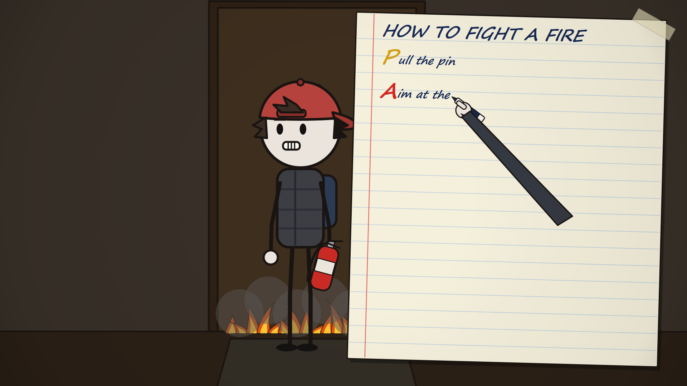

---

### C. October Wall Calendar Countdown (`draw_october_calendar`)
- Pinned to a warm brown wall (`#7A5E42`, pulsing crimson during `1 DAY LEFT` and `HOUR ZERO`) with a red pushpin at top center.
- 5×7 grid for `OCTOBER` with Thursday `23` circled in thick red marker (`9 PM`).
- At each day transition, the cartoon hand with a red marker draws a bold red `X` over the completed day (`17` through `23`) and writes the countdown title (`6 DAYS LEFT`, `5 DAYS LEFT`, …, `HOUR ZERO`) at the bottom.
- From Day 4 onward, brown cardboard (`THIS SIDE UP ↑`) is taped over the window beside the calendar.

---

### D. Smartphone Emergency Alerts & Investigation Boards
- **Emergency Alert Screen (`draw_smartphone_alert`):**
  - Tilted dark smartphone bezel held in one or two cartoon hands against a pulsing crimson radial backlight.
  - Red alert card (`#BF1515`) with yellow warning triangle, `COUNTY ALERT · now`, bold uppercase title (`EMERGENCY ALERT`), line-by-line text reveal, yellow highlighter sweep over the key survival phrase, and `Sender: Ashford County · Operator: EW04` footer.
- **Investigation Board (`draw_ellen_ward_board`):**
  - Connects clues on a dark background using animated red dashed curves (`Signed, Ellen Ward` business card $\rightarrow$ Polaroid `ALERT TEST / Operator: EW04` labeled `same person`, plus the `Zone 1..4` quadrant map with `Zone 4` circled in red).

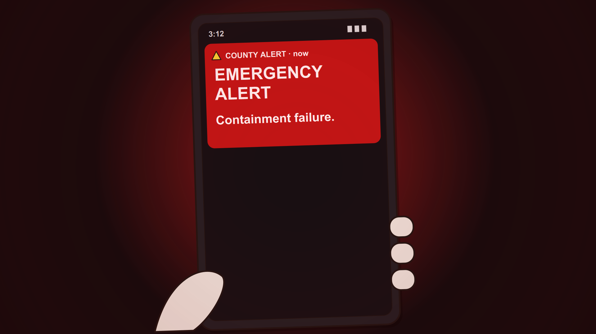

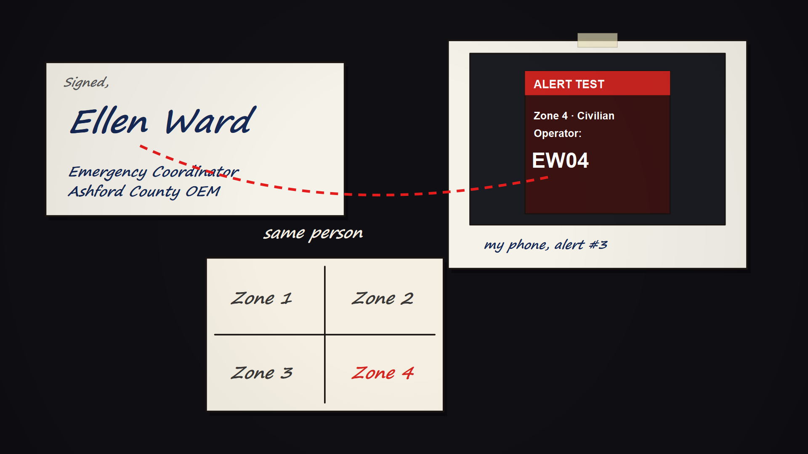

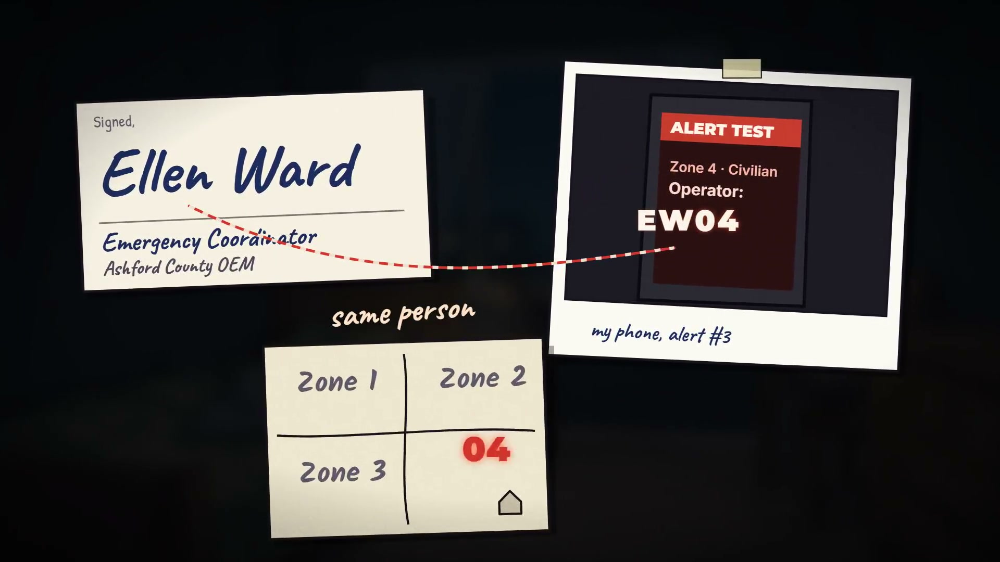

---

### E. Technical Survival Cutaways & Diagrams (`engine/diagrams.py`)
Whenever the narrator explains a physical mechanism or survival rule, cut immediately to a clean, high-contrast diagram:
1. **Calorie Tube Meter (`draw_calorie_tube_overlay`):** Glass test-tube filling with peanut butter arcing out of a jar on the table until it hits `2,500` calories and cracks the glass!
2. **Architectural Door Cross-Section (`draw_door_cross_section` & `draw_screw_stud_inset`):** Top-down diagram (`Your front door, from above`) showing how a 1-inch screw only holds the thin `frame` while a **3-inch brass screw** bites deep into the `wall stud`.
3. **120-Gallon Water Stack (`draw_water_stack_120_diagram`):** `30 jugs` + `40 tub` + `50 heater` stacking into a single `120 gallons` column with a red curly brace.
4. **Bug-Out Backpack X-Ray (`draw_backpack_xray`):** Top-down dashed X-ray inside the backpack on a wood plank floor (`2 gal water`, `3 days`, `RICE`, `food`, `radio`, `first aid`).

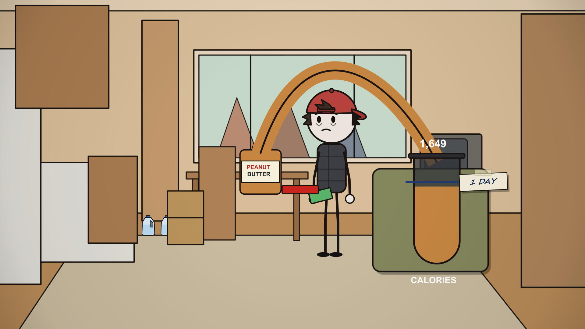

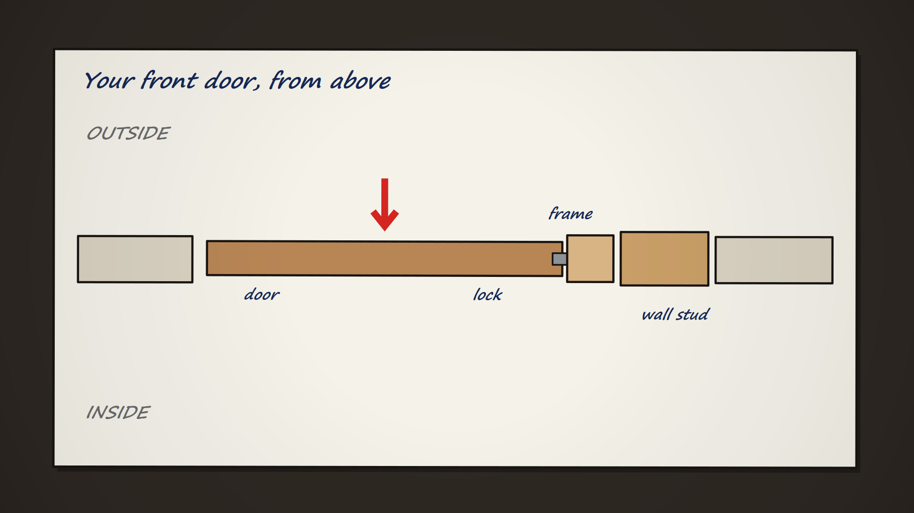

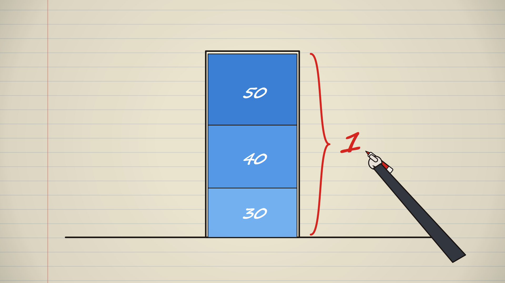

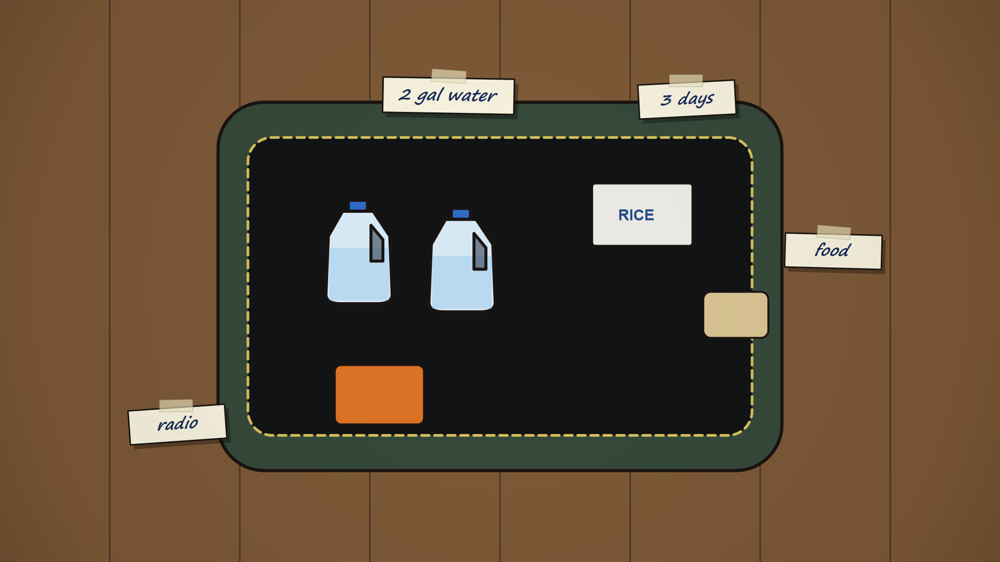

---

### F. High-Tension Action, Peephole Horror & Finale
- **Vertical Phone Footage (`draw_hospital_phone_video`):** 9:16 vertical social-video frame showing the hospital hallway zombie attack, followed by a 3×3 thumbnail grid turning `Video unavailable` one by one.
- **Circular Fisheye Peephole Sequence (`peephole_sequence`):** Dark circular viewport with glass rim reflection showing the neighbor in his straw garden hat, closeup of the bloody bite on his wrist, soil-blackened fingernails reaching under the door gap, and his tilted grey-green zombie head lunging at the peephole.
- **Hallway Extinguisher Fight & Rooftop Nuclear Finale:** Blasting white chemical powder, swinging the red fire extinguisher cylinder, wedging the rooftop door handle, and the final wide rooftop shot with an expanding white-blue shockwave dome and towering nuclear mushroom cloud.

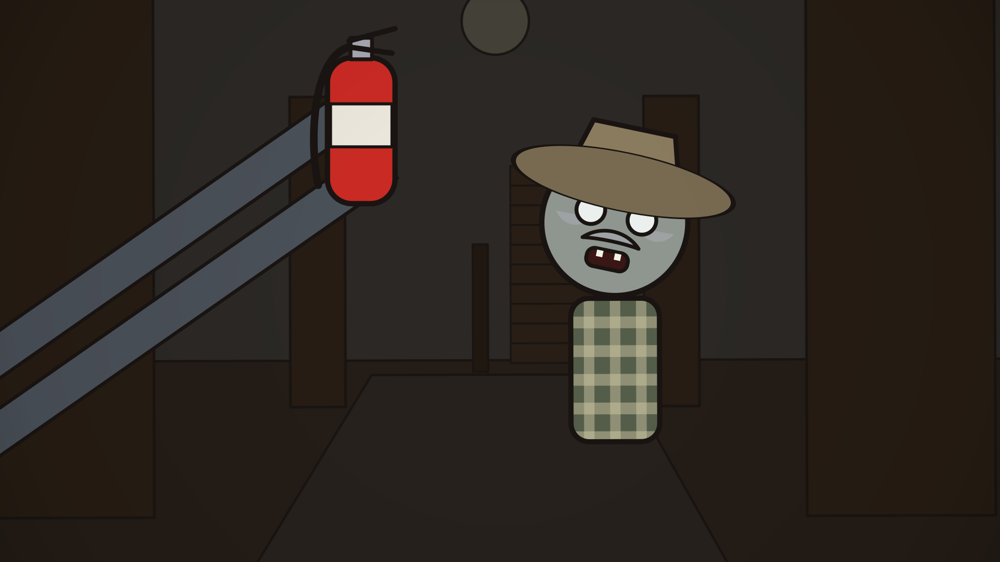

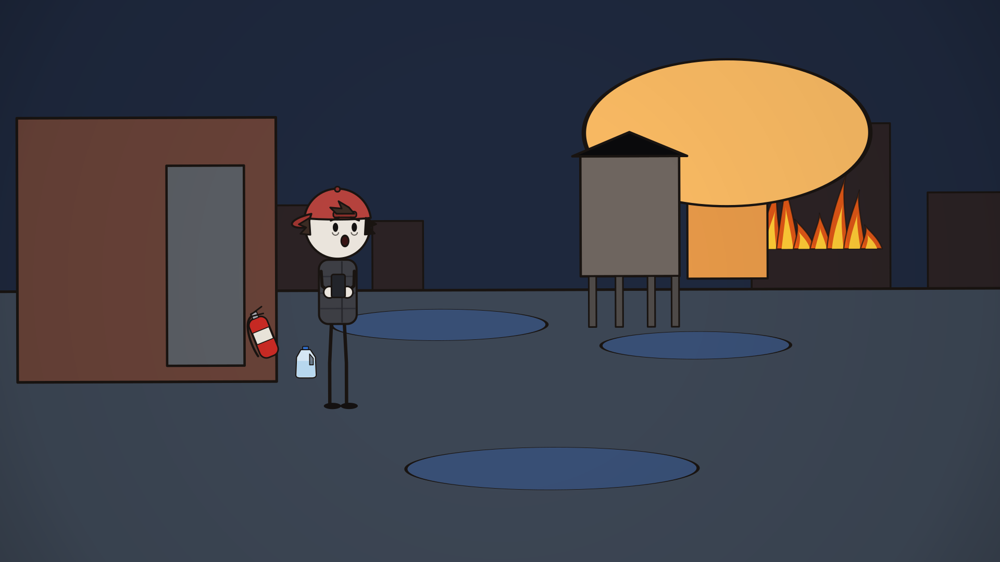

---

## 3. Step-by-Step Execution Pipeline for Future Videos

When creating or recreating a video with this skill, execute these 5 stages in order:

1. **Stage 1 — Forensic Probe & Keyframe Extraction**
   - Run `ffprobe` to record exact width, height, FPS, frame count, and audio codec.
   - Extract 60s video chunks (`-vf scale=640:360`) and 1080p keyframes (`frame_*.jpg`) into the scratch directory and inspect them with `read_file`.
2. **Stage 2 — Modular Vector Engine Setup (`engine/`)**
   - `engine/primitives.py`: Camera matrix (`apply_camera` with creeping zoom `1.00 -> 1.14`, pan, and procedural trauma shake), cached radial vignette (`draw_vignette`), pulsing red alarm overlay (`draw_red_alarm_pulse`), hand-inked boxes (`draw_ink_box`), scotch tape, slanted stamp banners, speech bubbles, digital clock, ECG waveform, sound-wave arcs, and fire plumes.
   - `engine/characters.py`: Rigged `draw_chad` (never `Melvin`), `draw_neighbor`, `draw_hand_with_pen`, `draw_water_jug`, and `draw_fire_extinguisher_prop`.
   - `engine/overlays.py`: `draw_notebook_card`, `draw_sticky_note_pad`, `draw_taped_label`, `draw_october_calendar`, and `draw_smartphone_alert`.
   - `engine/diagrams.py`: All technical cutaways, receipts, emails (`To: Chad`, `Chad H.`), investigation boards, and X-ray views.
   - `engine/environments.py` & `engine/environments_part2.py`: Cached `_get_cached_bg(key, builder_fn)` 1080p base surfaces so static room/exterior geometry renders once per worker process (>140–300 FPS).
   - `engine/timeline.py`: Master `SHOTS` table mapping `(t0, t1, zoom0, zoom1, pan_x, pan_y, shake, red_pulse, draw_fn)` across the entire duration.
   - **Font Glyph Rule:** Avoid raw Unicode emojis (`💧`, `🔍`, `🔕`) inside `Segoe Print` text strings (which render as `[]` boxes); always use vector mini-icons (`draw_mini_icon`) or clean ASCII text.
3. **Stage 3 — Smoke Test All Shots**
   - Before launching the full video encode, run a 2-second test rendering the start, midpoint, and end of every shot in `SHOTS` to catch any syntax or drawing errors upfront.
4. **Stage 4 — Multi-Worker Parallel NVENC Render (`recreate_video.py`)**
   - Split total frames across 6 parallel `ProcessPoolExecutor` workers (first 3 workers using `-c:v h264_nvenc -preset p4 -cq 20 -b:v 4500k`, remaining workers using `-c:v libx264 -preset veryfast -crf 20`).
   - Concatenate segments losslessly with `ffmpeg -f concat` and mux the stereo AAC audio track (`-map 0:v:0 -map 1:a:0 -c:v copy -c:a aac -b:a 192k -shortest`).
5. **Stage 5 — Interactive Studio (`index.html`) & Verification**
   - Build `index.html` with solo and synchronized side-by-side comparison players, frame stepping (`-1 / +1 Frame`), chapter quick-jump buttons, and a clickable shot-by-shot storyboard inspector.
   - Verify the final MP4 with `ffprobe` and inspect extracted frames via `read_file`.

---

## 4. Bundled Python Scripts & Engine Modules (`./scripts/`)

All executable Python scripts and procedural 2D vector engine modules are included directly inside this skill's `scripts/` folder for immediate reuse:

- **Forensic Reference Video Analyzer:** [analyze_reference_video.py](./scripts/analyze_reference_video.py)
  - Probes video metadata (`ffprobe`), extracts 60-second preview clips (`clip_0_60.mp4`, …), and dumps 1080p keyframes (`frame_*.jpg`).
- **Parallel Multi-Worker NVENC Video Renderer:** [recreate_video.py](./scripts/recreate_video.py)
  - Renders all 17,726 frames (`1920x1080` @ `30fps`) across 6 parallel worker processes (`h264_nvenc` + `libx264`), concatenates segments losslessly, and muxes the stereo audio track.
- **Procedural 2D Vector Engine Package (`./scripts/engine/`):**
  - [primitives.py](./scripts/engine/primitives.py): Camera zoom/pan/trauma-shake transform (`apply_camera`), cached radial vignette (`draw_vignette`), pulsing red alarm overlay (`draw_red_alarm_pulse`), hand-inked strokes, translucent scotch tape, slanted stamp banners, speech bubbles, digital LED clock, glowing red ECG heartbeat waveform, sound-wave arcs, and animated fire plumes.
  - [characters.py](./scripts/engine/characters.py): Rigged protagonist `draw_chad` (backward red cap, puffy vest, expressions, walk/sit/crouch/brace poses, held props), `draw_neighbor` (gardener vs. tilted-head zombie), and `draw_hand_with_pen`.
  - [overlays.py](./scripts/engine/overlays.py): `draw_notebook_card` (cream lined paper, spiral rings, highlighter header, hatched progress bars, red strikethrough updates, `tally` counters, `P-A-S-S` rows, `30 GAL = 1 MONTH` droplet grid, live writing hand), `draw_sticky_note_pad`, `draw_taped_label`, `draw_october_calendar`, and `draw_smartphone_alert`.
  - [diagrams.py](./scripts/engine/diagrams.py): All 15 bespoke cutaways and technical diagrams (`draw_email_printout` with `To: Chad` & `Chad H.`, `draw_card_terminal_split` with `CHAD`, `draw_ellen_ward_board`, `draw_door_cross_section`, `draw_strike_plate_ruler`, `draw_screw_stud_inset`, `draw_calorie_tube_overlay`, `draw_pantry_receipt`, `draw_water_stack_120_diagram`, `draw_backpack_xray`, `draw_calendar_6_summary`, `draw_cart_topdown`, `draw_power_out_atms`, `draw_fridge_4h_diagram`, `draw_water_heater_50gal_diagram`, `draw_folded_note_doormat`, `draw_hospital_phone_video`).
  - [environments.py](./scripts/engine/environments.py): Cached 1080p base surfaces + dynamic renderers for Birch Street Brownstone, Apocalypse Street, Chad's Bedroom, and Window Garden POV.
  - [environments_part2.py](./scripts/engine/environments_part2.py): Cached 1080p base surfaces + dynamic renderers for Living Room/Kitchen, Front Door, Supermarket Aisles, Ashford Savings Bank ATMs, CRT TV News, Bathroom & Water Heater Closet, 3rd/4th Floor Hallway & Peephole Sequence, and Rooftop Nuclear Finale.
  - [timeline.py](./scripts/engine/timeline.py): Complete 116-shot master dispatcher (`SHOTS` and `render_frame(ctx, t)`).

